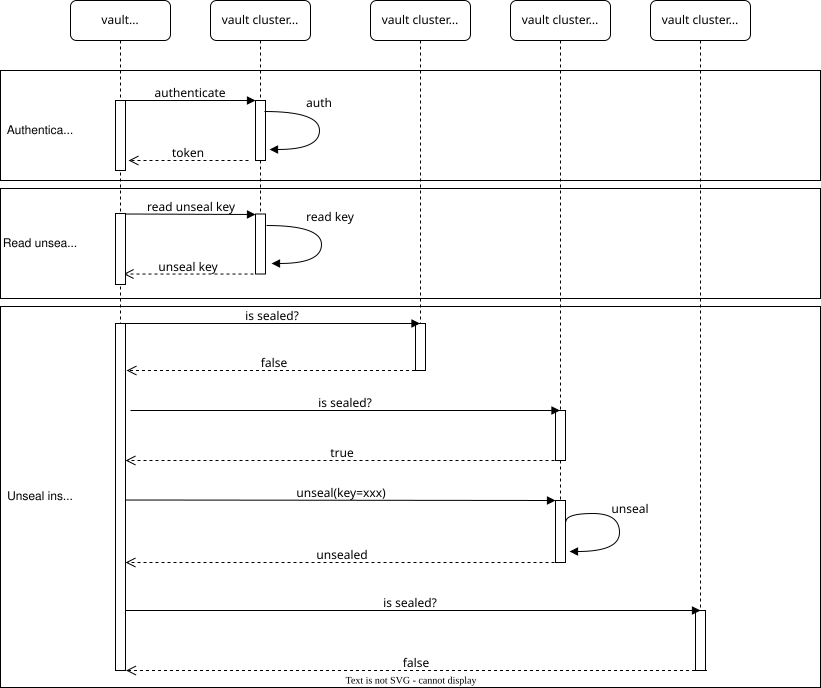

# vault-unsealer
[](https://goreportcard.com/report/github.com/soerenschneider/vault-unsealer)


A small daemon that watches a set of [HashiCorp Vault](https://www.vaultproject.io/) (or OpenBao) instances using
Shamir seals and automatically unseals them when they come back sealed — e.g. after a reboot, an OS update or a
container restart.

## Contents

- [Key Features](#key-features)
- [How Does It Work?](#how-does-it-work)
- [Installation](#installation)
- [Quick Start](#quick-start)
- [Configuration](#configuration)
  - [Command-line flags](#command-line-flags)
  - [File format](#file-format)
  - [Top-level settings](#top-level-settings)
  - [Cluster settings](#cluster-settings)
  - [Unseal key retrievers](#unseal-key-retrievers)
  - [Options shared by all retrievers](#options-shared-by-all-retrievers)
  - [Vault authentication](#vault-authentication)
  - [Full examples](#full-examples)
  - [Preparing the encrypted unseal key](#preparing-the-encrypted-unseal-key)
- [Observability](#observability)
- [Security Considerations](#security-considerations)
- [Known Limitations](#known-limitations)
- [FAQ](#faq)
- [Changelog](#changelog)

## Key Features

🔐 Retrieve unseal key shares from Vault's **transit** or **KV v2** secret engine, from **AWS KMS**, or (for testing) from the config file<br/>
🧩 Combine **multiple retrievers** to submit several key shares and reach the Shamir threshold<br/>
🧅 Optional **[age](https://age-encryption.org/)-wrapping** of key shares for defense in depth<br/>
🛂 Authenticate against Vault using **AppRole**, an explicit **token**, or **implicit** auth (`VAULT_TOKEN` / token file)<br/>
🧭 Watch a **fixed list of instances** or **discover them via DNS SRV** records<br/>
🔭 **Prometheus metrics** for alerting on sealed instances and failed unseal attempts<br/>

## How Does It Work?



1. On startup and then every `key_check_interval_s` seconds, vault-unsealer fetches the unseal key from **every**
   configured retriever, bypassing caches, so a broken key source is noticed before its key is actually needed. Failures
   are logged and reported via `vault_unsealer_unseal_key_retriever_healthy_bool` but are not fatal — the key source may
   only be temporarily unavailable, and a previously cached key is kept. Invalid configuration (unparsable file, missing
   ciphertext file, unknown auth type, …) terminates the process.
2. Every `check_interval_s` seconds it queries `GET /v1/sys/seal-status` on each configured endpoint. With
   [`endpoints_srv`](#discovering-instances-via-dns-srv), the instances are looked up via DNS right before each check.
3. If an instance reports `sealed: true`, it fetches the key shares of **all** retrievers concurrently and submits them
   in the configured order via `POST /v1/sys/unseal` until the instance is unsealed. Shares that aren't needed to reach
   the threshold are not sent to Vault, but they are still fetched, so caches of spare key sources stay populated and a
   broken key source is noticed (`vault_unsealer_unseal_key_retrieval_errors_total`) before it is actually needed.
   If the configured key sources can't provide enough distinct shares to reach the threshold, the available shares are
   submitted anyway, so an operator can enter the missing ones manually.

The unseal key is typically *not* stored in plaintext: it is kept encrypted (Vault transit, AWS KMS, optionally
wrapped with age) and only decrypted on demand by a *different*, always-available Vault cluster or KMS.

## Installation

### Docker / Podman
```shell
docker run -v /path/to/config-dir:/config ghcr.io/soerenschneider/vault-unsealer:main -conf /config/config.yaml
```

The image runs as `nonroot`, so make sure the config file (and any referenced `*_file`) is readable by UID 65532.

### Binaries
Download prebuilt binaries (linux amd64 / armv6 / aarch64) from the
[releases section](https://github.com/soerenschneider/vault-unsealer/releases).
Use the example [systemd unit](contrib/vault-unsealer.service) to run it at boot.

### From source
Requires a [Go SDK](https://go.dev/dl/) matching the version in [`go.mod`](go.mod).

```shell
git clone https://github.com/soerenschneider/vault-unsealer.git
cd vault-unsealer
make build          # produces ./vault-unsealer with version info embedded
```

## Quick Start

1. Encrypt one unseal key share with a transit key on an *other* Vault cluster (see
   [Preparing the encrypted unseal key](#preparing-the-encrypted-unseal-key)).
2. Create an AppRole on that cluster that may only call `decrypt` on that transit key.
3. Write `/etc/vault-unsealer.yaml`:

   ```yaml
   prometheus_addr: ":9132"
   clusters:
     - endpoints:
         - https://vault-1.example.com:8200
         - https://vault-2.example.com:8200
         - https://vault-3.example.com:8200
       check_interval_s: 60
       unseal_key_config:
         - impl: vault-transit
           vault_endpoint: https://vault-ops.example.com:8200
           vault_auth_type: approle
           vault_auth_config:
             role_id: 1b5c1d0c-...
             secret_id_file: /etc/vault-unsealer/secret-id
           vault_transit_mount_path: transit_vault_unsealer
           vault_transit_key_name: prod
           vault_transit_ciphertext_file: /etc/vault-unsealer/unseal-key.ciphertext
   ```

4. Start it: `vault-unsealer -conf /etc/vault-unsealer.yaml`

## Configuration

### Command-line flags

| Flag       | Default                    | Description                         |
|------------|----------------------------|-------------------------------------|
| `-conf`    | `/etc/vault-unsealer.json` | Path to the configuration file.     |
| `-debug`   | `false`                    | Enable debug logging.               |
| `-version` | `false`                    | Print version and commit, then exit. |

There is no environment-variable configuration, except for what the underlying SDKs read themselves
(`VAULT_TOKEN` for [implicit auth](#implicit), the standard `AWS_*` variables for [AWS KMS](#aws-kms),
`SSL_CERT_FILE` / `SSL_CERT_DIR` for custom CA certificates).

### File format

The config file is parsed as **YAML**. Since JSON is valid YAML, JSON files work as well — the file extension does not
matter. Unknown keys are silently ignored, so double-check spelling.

Overall structure:

```yaml
prometheus_addr: ":9132"           # top-level settings
clusters:                          # list of clusters, each one is watched independently
  - endpoints: [...]               # cluster settings
    check_interval_s: 60
    unseal_key_config:             # list of retrievers, one per key share
      - impl: vault-transit        # retriever type
        ...                        # retriever-specific settings
        wrapped_passphrase: ...    # optional, shared by all retrievers
        cache: true                # optional, shared by all retrievers
```

### Top-level settings

| Key               | Type   | Required | Default | Description |
|-------------------|--------|----------|---------|-------------|
| `clusters`        | list   | yes      | –       | One or more [cluster definitions](#cluster-settings). Each cluster is watched concurrently with its own interval and key retrievers. |
| `prometheus_addr` | string | yes¹     | –       | Listen address of the Prometheus `/metrics` endpoint, e.g. `":9132"` or `"127.0.0.1:9132"`. |

¹ The code intends a default of `:9132`, but it is currently not applied. If omitted, the metrics server binds to
`:80`, which fails for non-root users and terminates the process. **Always set it explicitly.**

### Cluster settings

| Key                 | Type            | Required | Default | Description |
|---------------------|-----------------|----------|---------|-------------|
| `name`              | string          | no       | index   | Name of the cluster, used in logs and as `cluster` label in metrics. Defaults to the cluster's position in the list (`0`, `1`, …). Must be unique. |
| `endpoints`         | list of strings | one of²  | –       | Base URLs of all Vault instances to watch, e.g. `https://vault-1.example.com:8200` (no trailing slash, no `/v1`). |
| `endpoints_srv`     | object          | one of²  | –       | Discover the instances via a DNS SRV record instead, see [below](#discovering-instances-via-dns-srv). |
| `check_interval_s`  | integer         | yes      | –       | Seconds between seal-status checks. Must be between `60` and `3600`. |
| `key_check_interval_s` | integer     | no       | `86400` | Seconds between checks of all key sources, see [How does it work](#how-does-it-work). Must be between `60` and `86400`. |
| `unseal_key_config` | list of objects | yes      | –       | One or more [retrievers](#unseal-key-retrievers). Each retriever yields **one key share**. If your seal threshold is 3, configure 3 retrievers, each returning a different share. |
| `cache_unseal_key`  | bool            | no       | –       | *Deprecated, has no effect.* Use the per-retriever [`cache`](#options-shared-by-all-retrievers) option instead. |

² Set exactly one of `endpoints` or `endpoints_srv`.

#### Discovering instances via DNS SRV

Instead of a fixed list of `endpoints`, the instances of a cluster can be looked up via a DNS SRV record:

```yaml
clusters:
  - name: prod
    endpoints_srv:
      record: _vault._tcp.vault.example.com   # full name of the SRV record
      scheme: https                           # optional, http or https
    check_interval_s: 60
    unseal_key_config: [...]
```

| Key      | Type   | Required | Default | Description |
|----------|--------|----------|---------|-------------|
| `record` | string | yes      | –       | Full name of the SRV record, including service and protocol, e.g. `_vault._tcp.vault.example.com`. |
| `scheme` | string | no       | `https` | URL scheme of the discovered instances, `http` or `https`. |

- The record is looked up before every seal-status check, so instances added to or removed from the record are picked
  up within `check_interval_s`.
- Each target becomes `<scheme>://<target>:<port>`. Priority and weight are ignored, since every instance needs to be
  unsealed. A target of `.` (service not available) is skipped.
- With `https`, the instance's TLS certificate must be valid for the target host name from the SRV record.
- If the lookup fails or returns no targets, the instances of the last successful lookup are used, so a temporary DNS
  outage doesn't keep known instances sealed. Failures are reported via
  `vault_unsealer_agent_endpoint_discovery_errors_total`. If no lookup has succeeded yet, no instances are checked.
- Metrics of instances that disappear from the record are removed, so they don't trigger stale alerts.

### Unseal key retrievers

Every entry in `unseal_key_config` must have an `impl` key selecting the retriever type:

| `impl`          | Source of the key share                                                   |
|-----------------|---------------------------------------------------------------------------|
| `vault-transit` | Ciphertext stored locally, decrypted by a transit key on a Vault cluster. |
| `vault-kv2`     | Read from a KV v2 secret on a Vault cluster.                              |
| `aws-kms`       | Ciphertext stored locally, decrypted by AWS KMS.                          |
| `static`        | Plaintext in the config file. **Testing only.**                           |

#### vault-transit

Recommended. The key share never exists in plaintext on disk; the transit cluster only needs `update` on
`<mount>/decrypt/<key>`.

| Key                             | Type   | Required | Default | Description |
|---------------------------------|--------|----------|---------|-------------|
| `vault_endpoint`                | URL    | yes      | –       | Base URL of the Vault cluster hosting the transit engine. Used for both login and decrypt. |
| `vault_auth_type`               | string | yes      | –       | `approle`, `token` or `implicit`. See [Vault authentication](#vault-authentication). |
| `vault_auth_config`             | object | depends  | –       | Auth-specific settings. Required for `approle` and `token`. |
| `vault_transit_mount_path`      | string | yes      | –       | Mount path of the transit engine, e.g. `transit`. There is no default. |
| `vault_transit_key_name`        | string | yes      | –       | Name of the transit key. |
| `vault_transit_ciphertext`      | string | one of³  | –       | The ciphertext (`vault:v1:...`) inline. |
| `vault_transit_ciphertext_file` | path   | one of³  | –       | File containing the ciphertext. Read once at startup, surrounding whitespace is stripped. |

³ Set exactly one of `vault_transit_ciphertext` or `vault_transit_ciphertext_file`. If both are set, the file wins.

The decrypted plaintext is base64-decoded and a trailing newline is stripped. Without `cache`, the key share is
decrypted (and an AppRole login performed) on every unseal attempt.

#### vault-kv2

| Key                     | Type   | Required | Default      | Description |
|-------------------------|--------|----------|--------------|-------------|
| `vault_endpoint`        | URL    | yes      | –            | Base URL of the Vault cluster holding the secret. |
| `vault_auth_type`       | string | yes      | –            | `approle`, `token` or `implicit`. |
| `vault_auth_config`     | object | depends  | –            | Auth-specific settings. Required for `approle` and `token`. |
| `vault_kv2_mount_path`  | string | no       | `secret`     | Mount path of the KV v2 engine. |
| `vault_kv2_secret_path` | string | yes      | –            | Path of the secret below the mount, e.g. `infra/vault-unsealer`. |
| `vault_kv2_secret_key`  | string | no       | `unseal_key` | Key inside the secret's data that holds the key share. |

The secret is read from `<vault_endpoint>/v1/<mount>/data/<secret_path>`; the latest version is used.

#### aws-kms

| Key                           | Type   | Required | Default            | Description |
|-------------------------------|--------|----------|--------------------|-------------|
| `aws_transit_ciphertext`      | string | one of⁴  | –                  | Base64-encoded KMS ciphertext blob. |
| `aws_transit_ciphertext_file` | path   | one of⁴  | –                  | File containing the base64-encoded ciphertext blob. Read once at startup. |
| `aws_region`                  | string | no       | AWS SDK default    | Region of the KMS key. Overrides `AWS_REGION` / shared config. |
| `aws_kms_key_id`              | string | no       | –                  | Key ID, key ARN, alias name or alias ARN of the KMS key. If set, KMS refuses to decrypt ciphertexts of any other key. |
| `encryption_context`          | map    | no       | –                  | KMS encryption context; must match the context used at encryption time. |

⁴ Set exactly one of them. If both are set, the file wins.

AWS credentials are resolved via the standard
[AWS SDK default credential chain](https://docs.aws.amazon.com/sdk-for-go/v2/developer-guide/configure-gosdk.html)
(environment variables, shared config/credentials files, IAM Roles Anywhere, EC2/ECS instance roles, …). The KMS key
ID does not need to be configured, as it is embedded in the ciphertext. Setting `aws_kms_key_id` is still recommended
if the IAM principal may use more than one key: it ensures a swapped ciphertext of another key is rejected. Use
[`contrib/aws-kms`](contrib/aws-kms/main.go) to produce the ciphertext.

#### static

| Key          | Type   | Required | Description |
|--------------|--------|----------|-------------|
| `unseal_key` | string | yes      | The key share in plaintext. |

Meant for testing only — anyone who can read the config file can unseal your Vault. Combining it with
`wrapped_passphrase` doesn't help much either, since the passphrase sits right next to the ciphertext.

### Options shared by all retrievers

These keys can be added to any entry in `unseal_key_config`:

| Key                  | Type   | Default | Description |
|----------------------|--------|---------|-------------|
| `wrapped_passphrase` | string | –       | If set, the value returned by the retriever is treated as base64-encoded [age](https://age-encryption.org/) ciphertext (scrypt / passphrase mode) and decrypted with this passphrase. Must be **at least 25 characters**. |
| `wrapped_passphrase_file` | path | –     | Like `wrapped_passphrase`, but the passphrase is read from this file once at startup. Leading and trailing whitespace is stripped, the remaining passphrase must be **at least 25 characters**. Keeps the passphrase out of the config file. If both are set, the file wins. |
| `cache`              | bool   | `false` | Keep the key share in memory after the first successful retrieval, so instances can be unsealed even if the source (e.g. the transit cluster) is unavailable later. Honored by all retrievers. If an instance rejects the keys (e.g. after a rekey), all cached keys of the cluster are discarded, fetched again from their sources, and unsealing is retried once. |

With age-wrapping, an attacker needs *both* the config file (passphrase) *and* access to the key source to recover a
key share.

### Vault authentication

Applies to the `vault-transit` and `vault-kv2` retrievers.

#### approle

Recommended.

```yaml
vault_auth_type: approle
vault_auth_config:
  role_id: 1b5c1d0c-7e1d-4b51-a8c1-1f3c2b3b0f9a
  secret_id_file: /etc/vault-unsealer/secret-id
  approle_mount: approle
```

| Key              | Type   | Required | Default   | Description |
|------------------|--------|----------|-----------|-------------|
| `role_id`        | string | yes      | –         | The AppRole role ID. |
| `secret_id`      | string | one of⁵  | –         | The secret ID inline. |
| `secret_id_file` | path   | one of⁵  | –         | File containing the secret ID. Read on every login (so it can be rotated externally), surrounding whitespace is stripped. |
| `approle_mount`  | string | no       | `approle` | Mount path of the AppRole auth method. |

⁵ If both are set, `secret_id` wins.

The token obtained by logging in is reused until 80% of its TTL has passed, then a new login is performed. If Vault
rejects the token earlier (e.g. it was revoked or `token_num_uses` is exhausted), vault-unsealer logs in again and
retries the request once. On shutdown, the token is revoked.

#### token

Not recommended: the token is static and needs to be renewed or replaced manually.

```yaml
vault_auth_type: token
vault_auth_config:
  token: hvs.CAESI...
```

| Key     | Type   | Required | Description       |
|---------|--------|----------|-------------------|
| `token` | string | yes      | The Vault token.  |

#### implicit

Uses a token provided by the environment — useful together with Vault Agent or an external rotation tool.
`vault_auth_config` is not needed.

```yaml
vault_auth_type: implicit
```

The token is taken from

1. the `VAULT_TOKEN` environment variable, or, if unset,
2. the file `.vault-token` **in the current working directory** of the process (not `~/.vault-token`). The file is
   used verbatim, so write it without a trailing newline.

### Full examples

#### Transit with AppRole and age-wrapping (YAML)

```yaml
prometheus_addr: "127.0.0.1:9132"
clusters:
  - endpoints:
      - https://vault-1.example.com:8200
      - https://vault-2.example.com:8200
      - https://vault-3.example.com:8200
    check_interval_s: 60
    unseal_key_config:
      - impl: vault-transit
        vault_endpoint: https://vault-ops.example.com:8200
        vault_auth_type: approle
        vault_auth_config:
          role_id: 1b5c1d0c-7e1d-4b51-a8c1-1f3c2b3b0f9a
          secret_id_file: /etc/vault-unsealer/secret-id
        vault_transit_mount_path: transit_vault_unsealer
        vault_transit_key_name: prod
        vault_transit_ciphertext_file: /etc/vault-unsealer/unseal-key.ciphertext
        wrapped_passphrase: "correct-horse-battery-staple-and-more"
```

#### Threshold of 2 with two independent sources (JSON)

Each retriever returns a *different* key share, so compromising a single source is not enough to unseal.

```json
{
  "prometheus_addr": ":9132",
  "clusters": [
    {
      "endpoints": ["https://vault-1.example.com:8200", "https://vault-2.example.com:8200"],
      "check_interval_s": 120,
      "unseal_key_config": [
        {
          "impl": "aws-kms",
          "aws_region": "eu-central-1",
          "aws_kms_key_id": "alias/vault-unseal",
          "aws_transit_ciphertext_file": "/etc/vault-unsealer/share-1.kms",
          "encryption_context": { "purpose": "vault-unseal" },
          "cache": true
        },
        {
          "impl": "vault-kv2",
          "vault_endpoint": "https://vault-ops.example.com:8200",
          "vault_auth_type": "implicit",
          "vault_kv2_mount_path": "secret",
          "vault_kv2_secret_path": "infra/vault-unsealer",
          "vault_kv2_secret_key": "share_2",
          "cache": true
        }
      ]
    }
  ]
}
```

More examples: [`contrib/example-config.json`](contrib/example-config.json),
[`contrib/example-config-static.json`](contrib/example-config-static.json),
[`contrib/example-config-srv.json`](contrib/example-config-srv.json) (instances discovered via DNS SRV).

### Preparing the encrypted unseal key

#### Vault transit

On the cluster that will decrypt the key share:

```shell
vault secrets enable -path=transit_vault_unsealer transit
vault write -f transit_vault_unsealer/keys/prod

# encrypt one key share; printf avoids a trailing newline
vault write -field=ciphertext transit_vault_unsealer/encrypt/prod \
    plaintext="$(printf '%s' "$UNSEAL_KEY_SHARE" | base64)" \
  | tr -d '\n' > unseal-key.ciphertext
```

Policy for the AppRole used by vault-unsealer:

```hcl
path "transit_vault_unsealer/decrypt/prod" {
  capabilities = ["update"]
}
```

See also [`contrib/encrypt-unseal-key.sh`](contrib/encrypt-unseal-key.sh).

#### Vault KV v2

```shell
vault kv put -mount=secret infra/vault-unsealer unseal_key="$UNSEAL_KEY_SHARE"
```

```hcl
path "secret/data/infra/vault-unsealer" {
  capabilities = ["read"]
}
```

#### AWS KMS

Use the interactive helper, which optionally age-wraps the share before encrypting it with KMS:

```shell
go run ./contrib/aws-kms > share-1.kms
```

The helper does not set an encryption context; leave `encryption_context` empty for ciphertexts it produced.
The IAM principal used by vault-unsealer only needs `kms:Decrypt` on the key. A Terraform example lives in
[`contrib/tf`](contrib/tf).

#### age-wrapping (any retriever)

Wrap the key share with age *before* storing it in the backend, then set `wrapped_passphrase`:

```shell
printf '%s' "$UNSEAL_KEY_SHARE" | age --passphrase | base64 | tr -d '\n'
```

Store the resulting string where the retriever expects the key share (transit plaintext, KV secret, KMS plaintext).

## Observability

Metrics are exposed in Prometheus format on `http://<prometheus_addr>/metrics`.

| Metric                                                | Type    | Labels                    | Description |
|-------------------------------------------------------|---------|---------------------------|-------------|
| `vault_unsealer_version`                              | gauge   | `version`, `hash`         | Always `1`; build info. |
| `vault_unsealer_start_time_seconds`                   | gauge   | –                         | Process start time (Unix seconds). |
| `vault_unsealer_unseal_key_retrieval_errors_total`    | counter | `cluster`, `retriever`    | Failed attempts to retrieve a key share, including the periodic key source checks. |
| `vault_unsealer_unseal_key_retriever_healthy_bool`    | gauge   | `cluster`, `retriever`    | Result of the last key source check, bypassing caches: `1` = healthy, `0` = failing. |
| `vault_unsealer_agent_last_check_timestamp_seconds`   | gauge   | `vault_instance`          | Time of the last seal-status check per instance. |
| `vault_unsealer_agent_unsealed_bool`                  | gauge   | `vault_instance`          | Seal status at the last check: `1` = unsealed, `0` = sealed. |
| `vault_unsealer_agent_unseal_errors_total`            | counter | `error`, `vault_instance` | Errors per instance; `error` is `sealed_query_failed` or `unseal_failed`. |
| `vault_unsealer_agent_instances`                      | gauge   | `cluster`                 | Number of instances of a cluster found by the last successful discovery (static `endpoints` or DNS SRV). |
| `vault_unsealer_agent_endpoint_discovery_errors_total` | counter | `cluster`                | Failed DNS SRV lookups, see [`endpoints_srv`](#discovering-instances-via-dns-srv). |

Example alerts:

```yaml
- alert: VaultSealed
  expr: vault_unsealer_agent_unsealed_bool == 0
  for: 10m
- alert: VaultUnsealerStale
  expr: time() - vault_unsealer_agent_last_check_timestamp_seconds > 3 * 300
- alert: VaultUnsealerKeySourceFailing
  expr: vault_unsealer_unseal_key_retriever_healthy_bool == 0
```

## Security Considerations

- vault-unsealer holds (or can obtain) unseal key shares. Treat the host it runs on as part of Vault's trust boundary.
- Prefer `vault-transit` or `aws-kms` with ciphertext files over `vault-kv2`; never use `static` in production.
- Configure as few key shares as needed per source, and use multiple independent sources so that no single
  compromised system can unseal Vault on its own.
- Use `secret_id_file` / `*_ciphertext_file` with restrictive file permissions (`0400`) instead of inline secrets.
- TLS certificates are verified against the system trust store. For private CAs, set `SSL_CERT_FILE` rather than
  disabling verification (which is not supported anyway).
- `cache: true` keeps the plaintext key share in process memory for the lifetime of the process.

## Known Limitations

- Per-retriever fields are not validated at startup; mistakes surface as runtime errors.
- `prometheus_addr` has no effective default (see above).
- `cache_unseal_key` is accepted but has no effect.

## FAQ

**Q:** Why would I need auto-unsealing?<br/>
**A:** I'm trying to push OS-, container image- and Vault-updates itself rather aggressively, therefore I'm not patching any machines manually, but automatically (see [conditional-reboot](https://github.com/soerenschneider/conditional-reboot)). Hence, I need a mechanism that unseals preconfigured Vault instances automatically without human intervention.
<hr/>

**Q:** Ok, but why not using auto-unsealing using [AWS KMS](https://developer.hashicorp.com/vault/tutorials/auto-unseal/autounseal-aws-kms) / [Azure Key Vault](https://developer.hashicorp.com/vault/tutorials/auto-unseal/autounseal-azure-keyvault) / [GCP KMS](https://developer.hashicorp.com/vault/tutorials/auto-unseal/autounseal-gcp-kms)?<br/>
**A:** If your Vault clusters / instances do not run one of the specified cloud providers (like mine), you'll have to issue and deal with access keys to said platforms: distribute them secretly, keep them safe and rotate them frequently. Vault-unsealer [reads the unseal key from Vault itself](#how-does-it-work) (make sure it's well protected!) as I've written enough tooling that helps me keep my Vault credentials safe and rotate them both frequently and automatically (e.g. [vault-approle-cli](https://github.com/soerenschneider/scripts/blob/main/vault/vault-approle-cli.py) or [vault-mfa](https://github.com/soerenschneider/scripts/blob/main/vault/vault_mfa.py)).
<hr/>

**Q:** Why not using auto-unsealing using [Vault Transit](https://developer.hashicorp.com/vault/tutorials/auto-unseal/autounseal-transit)?<br/>
**A:** I did not want to manage another cluster / production instances of Hashicorp Vault even though I built some tooling around it that keeps maintenance low.
<hr/>

**Q:** Do only three real questions justify their own FAQ section?<br/>
**A:** Probably not, but here we are.
<hr/>

## Changelog

The changelog can be found [here](CHANGELOG.md).
